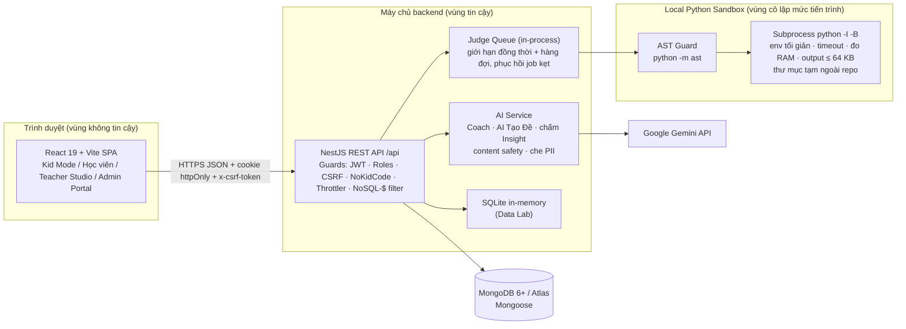
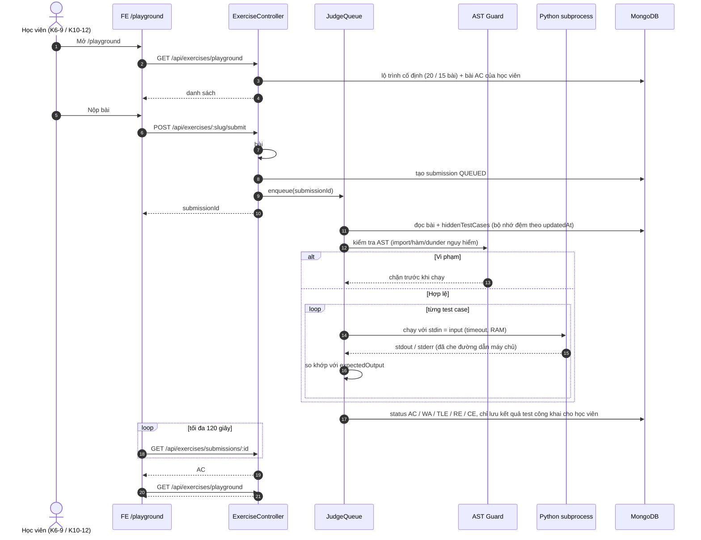
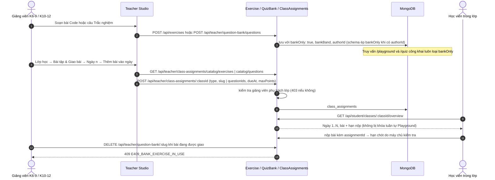
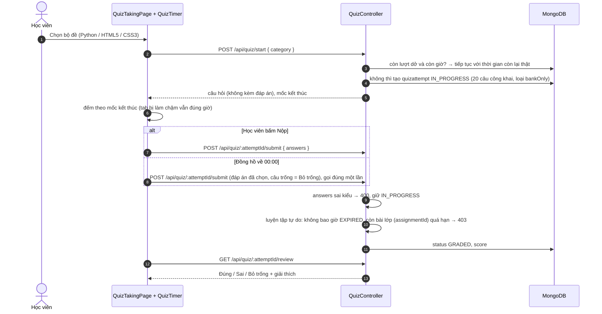

# ARCHITECTURE — CyberSoft Learning & Contest Hub v1.0

> Mô tả kiến trúc bản v1.0 đúng như mã nguồn hiện tại. Quyết định kiến trúc: [docs/decisions/](docs/decisions/).
> Chi tiết dữ liệu: [DATA.md](DATA.md) · API: [API.md](API.md) · Bảo mật: [SECURITY.md](SECURITY.md).

## 1. Sơ đồ tổng thể

| Thành phần | Công nghệ                                           | Thư mục                                                                                                |
| ------------ | ----------------------------------------------------- | -------------------------------------------------------------------------------------------------------- |
| Frontend     | React 19, Vite, TanStack Query, CodeMirror 6, Blockly | `FE/src`                                                                                               |
| Backend      | NestJS, Mongoose                                      | `BE/src/modules-api/*`, `BE/src/common/*`                                                            |
| Máy chấm   | Judge queue + code runner local                       | `BE/src/modules-api/judge`, `BE/src/common/helper/code-runner.helper.ts`, `python-guard.helper.ts` |
| AI           | Gemini client, chế độ dự phòng khi thiếu key    | `BE/src/modules-api/coach`, `problem-generator`                                                      |
| Dữ liệu    | MongoDB (local hoặc Atlas)                           | `BE/src/modules-system/database/schemas`                                                               |
| Vận hành   | setup, seed, doctor, migrate, audit, E2E              | `scripts/`                                                                                             |

## 2. Luồng dữ liệu

### 2.1 Chấm code tuần tự trên `/playground`

### 2.2 Ngân hàng đề (`bankOnly: true`) → Giao bài theo Ngày

### 2.3 Thi trắc nghiệm `/quiz` 20 câu → hết giờ tự nộp, chấm GRADED

## 3. Trust boundaries

| Biên                          | Bên trong tin gì                                                                                                                                                  | Kiểm soát tại biên                                                                                                                                                                                                                                                                                               |
| ------------------------------ | ------------------------------------------------------------------------------------------------------------------------------------------------------------------- | -------------------------------------------------------------------------------------------------------------------------------------------------------------------------------------------------------------------------------------------------------------------------------------------------------------------- |
| **Trình duyệt → API** | Không tin bất kỳ dữ liệu nào từ client: vai trò, khối, trạng thái khóa tuần tự, hạn chót, số lần rời màn hình, điểm đều tính ở máy chủ | Cookie `httpOnly` `SameSite=Strict`, CSRF Double Submit (`x-csrf-token`), JWT đối chiếu DB mỗi request (`sessionsRevokedAt`, `revoked_tokens`, trạng thái khóa), `@Roles`, `NoKidCodeGuard`, chặn NoSQL `$`, rate limit, CORS allowlist, header bảo mật                                    |
| **API → Sandbox**       | Code học viên là không tin cậy                                                                                                                                 | AST guard trước khi chạy; `python -I -B`; env tối giản; thư mục tạm ngoài repo; timeout + giới hạn RAM; output ≤ 64 KB; che đường dẫn máy chủ ở stdout/stderr. **Không phải cô lập cấp hệ điều hành** (xem [ADR-001](docs/decisions/ADR-001-local-python-sandbox-over-docker.md)) |
| **API → Gemini**        | Nội dung gửi đi là dữ liệu của học viên                                                                                                                    | Che email/SĐT/CCCD trước khi gửi, không gửi `userId`, bộ lọc nội dung an toàn trẻ em, guard prompt injection, chế độ dự phòng khi lỗi                                                                                                                                                             |
| **API → MongoDB**       | Truy vấn do server dựng                                                                                                                                           | Mongoose schema, `select: false` cho `hiddenTestCases`/`officialSolution`, kiểm tra quyền sở hữu/lớp ở tầng service                                                                                                                                                                                     |

## 4. Data stores & schemas cốt lõi

| Collection         | Vai trò                | Trường quan trọng                                                                                                                                                                                  |
| ------------------ | ----------------------- | ----------------------------------------------------------------------------------------------------------------------------------------------------------------------------------------------------- |
| `users`          | Tài khoản             | `email`, `password` (bcrypt), `role` (STUDENT/TEACHER/ADMIN), `ageGroup` (3-5/6-9/10-12/CAREER_ADULT, chỉ học viên), `status` (ACTIVE/LOCKED), `studentCode`, `sessionsRevokedAt`    |
| `classrooms`     | Lớp học               | `code` (CL-xxxxxx), `teacherId`, `teacherIds[]`, `studentIds[]`, `ageGroup`, `courseKey` (khóa người đi làm), `archived`                                                           |
| `exercises`      | Bài tập               | `slug`, `type`, `difficulty`, `testCases[]`, `hiddenTestCases[]` (select: false), `timeLimitMs`, `memoryLimitMb`, `bankOnly`, `bankBand`, `authorId`, `topic`, `orderInTopic` |
| `questions`      | Câu trắc nghiệm      | `content`, `codeSnippet`, `options[]`, `explanation`, `category`, `gradeBands[]`, `bankOnly`, `authorId`                                                                              |
| `submissions`    | Bài nộp code          | `exerciseId`, `userId`, `assignmentId`, `status` (QUEUED/RUNNING/AC/WA/TLE/RE/CE/FAILED), `results[]`, `attempts`, `outOfSequence`, `integrity`                                       |
| `contests`       | Cuộc thi               | `startTime`, `endTime`, `durationMinutes`, `problems[]`, `registrations[]`, `gradeBand`, `integrityEnabled`, `status`                                                                 |
| `revoked_tokens` | Token đã đăng xuất | `jti`, `expiresAt` (TTL tự xóa khi token hết hạn)                                                                                                                                             |

Đầy đủ: [DATA.md](DATA.md).

## 5. Failure modes & recovery

| Sự cố                                    | Hành vi hệ thống                                                                                                                                                            | Phục hồi                                                                         |
| ------------------------------------------ | ------------------------------------------------------------------------------------------------------------------------------------------------------------------------------ | ---------------------------------------------------------------------------------- |
| Code học viên chạy quá giờ / quá RAM | Tiến trình bị dừng, trả **TLE** hoặc lỗi bộ nhớ; không làm treo API                                                                                           | Tự động; học viên sửa và nộp lại                                          |
| Bộ chạy code quá tải                   | Yêu cầu tương tác (Run, kiểm tra cú pháp) bị từ chối ngay khi hàng đợi vượt `CODE_RUNNER_MAX_QUEUE` (mặc định 50); bài Submit vẫn xếp hàng chờ chấm | Tăng `CODE_RUNNER_MAX_CONCURRENCY` / `CODE_RUNNER_MAX_QUEUE` theo số CPU     |
| Backend sập giữa lúc chấm              | Khi khởi động lại, `onModuleInit` quét job QUEUED/RUNNING bị kẹt và chấm lại; quá số lần thử thì **FAILED**                                             | Tự động (giả định một tiến trình)                                         |
| FE chờ chấm quá lâu                    | Poll tối đa 120 giây rồi báo hết thời gian chờ                                                                                                                         | Mở lại bài để xem kết quả cuối                                             |
| MongoDB mất kết nối                     | `GET /api/health` trả `"status":"degraded"`; các API trả lỗi                                                                                                           | Khôi phục Mongo; Mongoose tự kết nối lại                                     |
| Gemini rate limit (429) / không có key   | AI Coach và AI Tạo Đề chuyển chế độ dự phòng; Admin → Trạng thái API báo AI Gateway *Suy giảm*                                                                | Đợi quota hoặc cấu hình key mới ở Admin → Cấu hình (có hiệu lực ngay) |
| Dữ liệu lớp mồ côi                    | Thẻ *Submissions & Classes* báo *Suy giảm*                                                                                                                              | Gỡ nhãn ở `/admin/classes` hoặc `migrate-day29.js`                         |

Quy trình chi tiết: [docs/day30/OPERATIONS_RUNBOOK.md](docs/day30/OPERATIONS_RUNBOOK.md), [TROUBLESHOOTING.md](TROUBLESHOOTING.md).

## 6. Architecture Decision Records

| ADR                                                                                   | Quyết định                                                                  |
| ------------------------------------------------------------------------------------- | ------------------------------------------------------------------------------ |
| [ADR-001](docs/decisions/ADR-001-local-python-sandbox-over-docker.md)                  | Local Python Sandbox (subprocess + AST guard) thay cho Docker                  |
| [ADR-002](docs/decisions/ADR-002-question-bank-isolation-and-sequential-playground.md) | Cách ly Ngân hàng đề `bankOnly` và Code Playground mở khóa tuần tự |
| [ADR-003](docs/decisions/ADR-003-httponly-cookie-auth-and-age-band-isolation.md)       | Phiên cookie httpOnly + CSRF và phân tách theo nhóm tuổi                 |
