# Cẩm nang Quản trị viên & Giảng viên — CyberSoft Learning & Contest Hub v1.0

> Áp dụng cho bản phát hành **v1.0** (nhánh `feature/learning-hub-day30`, commit gốc `ac18440`).
> Mọi ảnh trong tài liệu được chụp từ trình duyệt Chrome thật trên dữ liệu mẫu chuẩn sau khi chạy `npm run seed:clean`,
> nên bạn có thể làm lại từng bước và thấy đúng màn hình như ảnh. Mật khẩu mọi tài khoản mẫu là `123456`
> (giá trị `DEFAULT_SEED_PASSWORD` trong `BE/.env`).

## Mục lục

- [0. Trước khi bắt đầu](#0-trước-khi-bắt-đầu)
- [Phần A — Quản trị viên (Admin Portal)](#phần-a--quản-trị-viên-admin-portal)
  - [A1. Quản lý người dùng `/admin/users`](#a1-quản-lý-người-dùng-adminusers)
  - [A2. Quản lý Lớp học & Khóa học `/admin/classes`](#a2-quản-lý-lớp-học--khóa-học-adminclasses)
  - [A3. Giám sát sức khỏe dữ liệu `/admin/health`](#a3-giám-sát-sức-khỏe-dữ-liệu-adminhealth)
  - [A4. Tổng quan, Cấu hình và Nhật ký](#a4-tổng-quan-cấu-hình-và-nhật-ký)
- [Phần B — Giảng viên (Teacher Studio V2)](#phần-b--giảng-viên-teacher-studio-v2)
  - [B1. Lớp học của tôi `/teacher/classes`](#b1-lớp-học-của-tôi-teacherclasses)
  - [B2. Soạn bài thủ công `/teacher/authoring`](#b2-soạn-bài-thủ-công-teacherauthoring)
  - [B3. AI Tạo Đề `/teacher/authoring/ai`](#b3-ai-tạo-đề-teacherauthoringai)
  - [B4. Ngân hàng đề `/teacher/authoring/bank`](#b4-ngân-hàng-đề-teacherauthoringbank)
  - [B5. Tổ chức Cuộc thi `/teacher/contests`](#b5-tổ-chức-cuộc-thi-teachercontests)
  - [B6. Chấm bài & Phản hồi `/teacher/grading`](#b6-chấm-bài--phản-hồi-teachergrading)
- [Phụ lục — Bảng mã lỗi thường gặp](#phụ-lục--bảng-mã-lỗi-thường-gặp)

---

## 0. Trước khi bắt đầu

| Việc | Cách làm |
|---|---|
| Mở hệ thống | Chạy `npm run dev` ở thư mục gốc repo, mở **http://localhost:5173** |
| Đưa dữ liệu về trạng thái chuẩn | `npm run seed:clean` (dọn dữ liệu mẫu rồi nạp lại; không đụng dữ liệu thật) |
| Tài khoản Quản trị viên | `admin@gmail.com` |
| Giảng viên theo khối | `teacher3-5@gmail.com` (lớp `CL-35KID01`), `teacher6-9@gmail.com` (`CL-69PY01`), `teacher10-12@gmail.com` (`CL-1012A1`) |
| Giảng viên tổng hợp | `teacher@gmail.com` (đồng phụ trách các lớp mẫu, lớp Tester QA, Data Lab, AI Lab) |

**Ba nguyên tắc vận hành cần nhớ:**

1. **Mọi thay đổi có hiệu lực ngay ở yêu cầu kế tiếp.** Backend kiểm tra lại vai trò, trạng thái khóa và phiên đăng nhập trong CSDL ở *mọi* request, nên khóa tài khoản hay thu hồi quyền không phải chờ token hết hạn.
2. **Không có thao tác xóa vĩnh viễn người dùng.** Admin chỉ khóa/mở khóa. Lớp học được *Lưu trữ* thay vì xóa.
3. **Mọi thao tác quản trị được ghi vào Nhật ký** (`/admin/audit`), không ai sửa hay xóa được.

---

# Phần A — Quản trị viên (Admin Portal)

Đăng nhập bằng `admin@gmail.com`. Hệ thống tự đưa Admin vào Admin Portal; mọi đường dẫn khác (kể cả trang học tập) đều quay về `/admin/dashboard`.

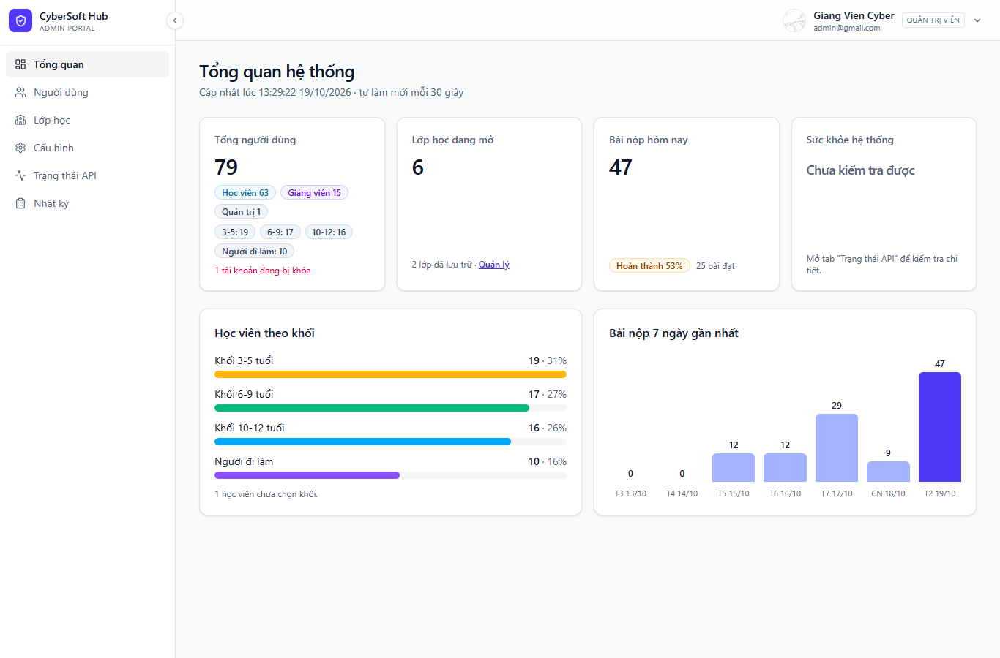
*Hình A.0 — Trang Tổng quan. Quan sát thanh điều hướng bên trái gồm 6 mục: Tổng quan, Người dùng, Lớp học, Cấu hình, Trạng thái API, Nhật ký.*

## A1. Quản lý người dùng `/admin/users`

### A1.1 Xem danh sách, tìm kiếm và lọc

**Bước 1.** Bấm **Người dùng** ở thanh bên trái.

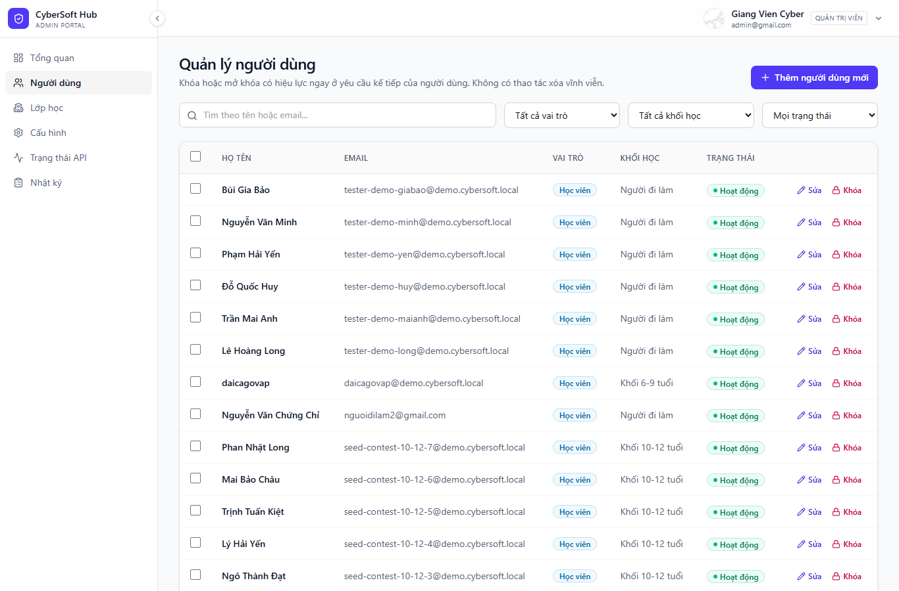
*Hình A.1 — Bảng người dùng 20 dòng/trang. Quan sát cột **Vai trò** (nhãn màu), cột **Khối học** (giảng viên/Admin luôn là "—"), cột **Trạng thái** (chấm xanh = Hoạt động, chấm đỏ = Đã khóa). Học viên có mã `Cxxxx` hiện dưới họ tên.*

**Bước 2.** Gõ tên hoặc email vào ô **Tìm theo tên hoặc email...** Bảng tự lọc sau khi bạn ngừng gõ khoảng 0,25 giây (không cần bấm Enter).

**Bước 3.** Dùng ba bộ lọc bên phải ô tìm kiếm, có thể kết hợp với nhau:

| Bộ lọc | Giá trị |
|---|---|
| Vai trò | Tất cả vai trò · Học viên · Giảng viên · Quản trị viên |
| Khối học | Tất cả khối học · Khối 3-5 tuổi · Khối 6-9 tuổi · Khối 10-12 tuổi · Người đi làm |
| Trạng thái | Mọi trạng thái · Hoạt động · Đã khóa |

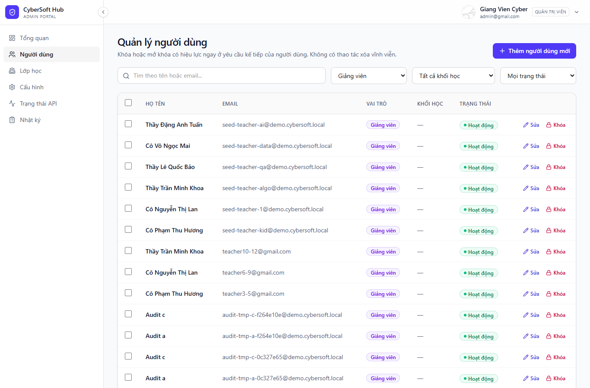
*Hình A.2 — Lọc "Giảng viên". Quan sát cột Khối học của mọi giảng viên đều là "—".*

**Bước 4.** Bấm vào **họ tên** một người để mở ngăn trượt hồ sơ: thông tin, các lớp đang học/phụ trách, tiến độ, bài nộp gần nhất.

**Thao tác hàng loạt.** Tick ô vuông đầu dòng (hoặc ô ở tiêu đề để chọn cả trang). Thanh công cụ nổi ở đáy màn hình hiện hai nút **Khóa tài khoản đã chọn** / **Mở khóa đã chọn** (tối đa 100 người một lần). Tài khoản Admin và chính bạn không chọn được; giảng viên đang đứng lớp được tự bỏ qua kèm lý do.

### A1.2 Thêm tài khoản mới

**Bước 1.** Bấm **+ Thêm người dùng mới** (góc trên bên phải).

**Bước 2.** Điền **Họ tên** (tối đa 100 ký tự), **Email**, **Mật khẩu ban đầu** (từ 6 ký tự; người dùng nên đổi sau lần đăng nhập đầu).

**Bước 3.** Chọn **Vai trò**: chỉ có *Học viên* hoặc *Giảng viên*.

*Hình A.3 — Vai trò Học viên: ô **Khối học** là danh sách chọn và bắt buộc ("Chọn khối học cho học viên.").*

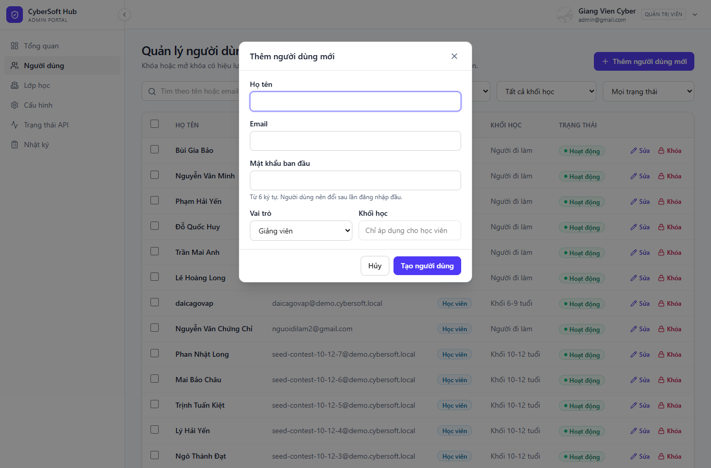
*Hình A.4 — Vai trò Giảng viên: ô Khối học chuyển thành chữ xám **"Chỉ áp dụng cho học viên"** và không bấm được.*

**Vì sao ô Khối học bị ẩn với Giảng viên?** Khối học (`ageGroup`) quyết định học viên thấy bài nào, vào lớp nào và được tính vào sĩ số khối nào. Giảng viên không thuộc khối nào, nên nếu lưu khối cho giảng viên thì số liệu "Học viên theo khối" và sĩ số lớp sẽ sai. Backend chặn lần thứ hai: nếu client cố gửi `ageGroup` kèm vai trò giảng viên thì trường này bị bỏ qua.

**Vì sao không có lựa chọn Quản trị viên?** Không ai được tạo hay nâng quyền thành Admin từ giao diện hoặc API (chống leo thang đặc quyền). API trả `403 "Không được tạo tài khoản quản trị viên."`.

**Bước 4.** Bấm **Tạo người dùng**. Học viên mới được cấp mã `Cxxxx` tự tăng. Email trùng trả lỗi `409 "Email đã được sử dụng."`.

### A1.3 Sửa thông tin và chuyển đổi vai trò

**Bước 1.** Bấm **Sửa** ở cuối dòng người dùng.

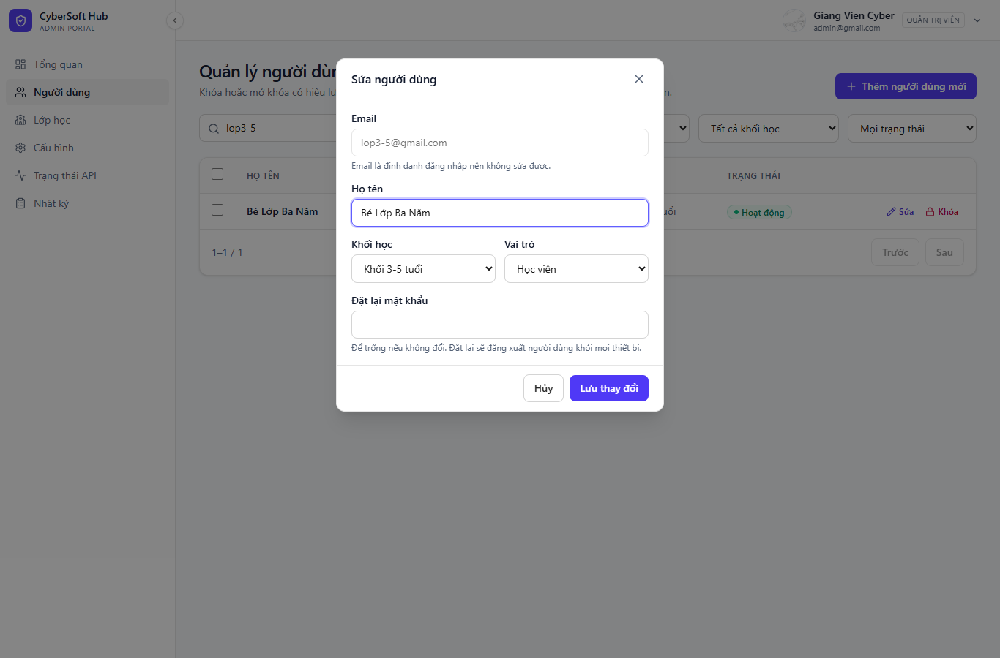
*Hình A.5 — Hộp Sửa người dùng. Email là định danh đăng nhập nên bị khóa. Với học viên, ô Vai trò là danh sách chọn; với giảng viên, ô này là nút **Thu hồi quyền giảng viên...**.*

**Bước 2.** Sửa **Họ tên**, **Khối học** (chỉ với học viên) hoặc nhập **Đặt lại mật khẩu** (để trống nếu không đổi). Đặt lại mật khẩu sẽ **đăng xuất người đó khỏi mọi thiết bị**.

**Bước 3 (tùy chọn) — Nâng Học viên lên Giảng viên.** Chọn Vai trò = *Giảng viên* rồi bấm **Lưu thay đổi**. Hệ thống tự động, trong cùng một lần lưu:

- **Xóa `ageGroup`** của tài khoản (cột Khối học về "—");
- **Rút tài khoản khỏi danh sách học viên (`studentIds`) của mọi lớp**, để sĩ số lớp không còn đếm một giảng viên;
- Giữ lại mã học viên cũ (ẩn) để nếu sau này hạ về học viên thì dùng lại đúng mã.

**Bước 3' — Đổi khối của học viên** (ví dụ 3-5 → Người đi làm). Học viên bị **rút khỏi mọi lớp thuộc khối khác**. Khóa Người đi làm không lưu danh sách học viên nên không bị ảnh hưởng.

**Bước 4 — Hạ Giảng viên về Học viên / Khóa hẳn.** Bấm **Thu hồi quyền giảng viên...**, chọn *Hạ về học viên* hoặc *Khóa tài khoản*, bấm **Thu hồi quyền**. Mọi phiên đăng nhập của người đó bị hủy ngay. Nếu giảng viên còn phụ trách lớp, hệ thống trả `409` kèm danh sách lớp và đường dẫn **Đi tới Quản lý lớp học để chuyển giao**.

### A1.4 Khóa / Mở khóa tài khoản

**Bước 1.** Bấm **Khóa** (chữ đỏ, biểu tượng ổ khóa) ở cuối dòng.

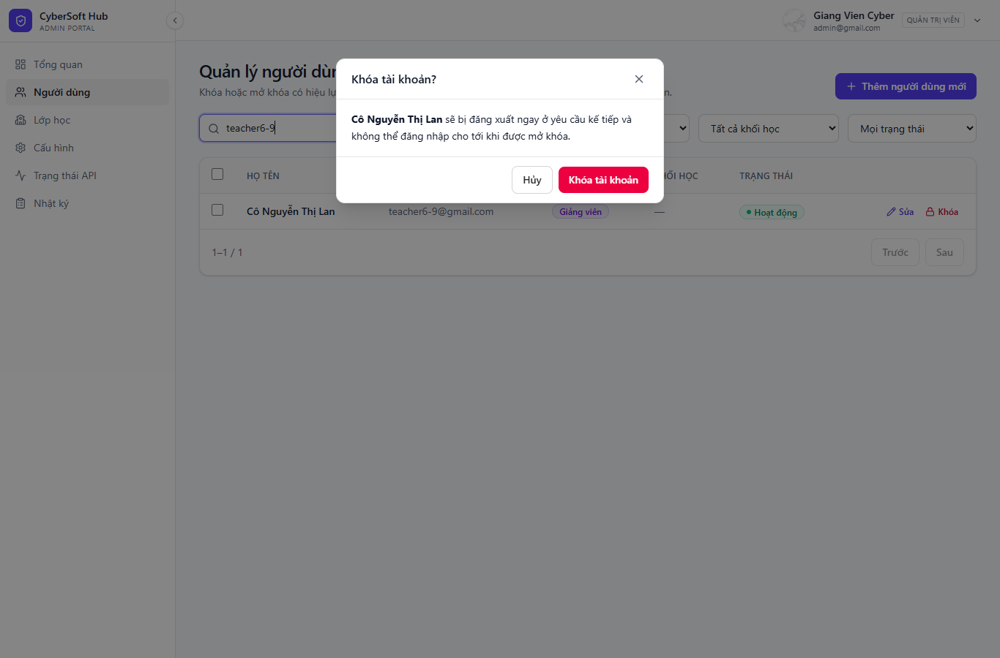
*Hình A.6 — Hộp xác nhận nói rõ hậu quả: người dùng bị đăng xuất ngay ở yêu cầu kế tiếp và không đăng nhập được cho tới khi được mở khóa.*

**Bước 2.** Bấm **Khóa tài khoản**.

> **⚠ Cảnh báo 409 — Giảng viên đang đứng lớp.** Nếu tài khoản là giảng viên còn phụ trách ít nhất một lớp **đang hoạt động**, hệ thống từ chối khóa:

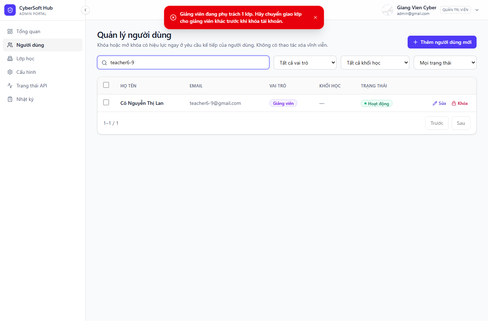
*Hình A.7 — Thông báo đỏ: "Giảng viên đang phụ trách 1 lớp. Hãy chuyển giao lớp cho giảng viên khác trước khi khóa tài khoản." Trạng thái tài khoản vẫn là Hoạt động.*

**Cách xử lý:**

1. Vào **Lớp học**, mở lớp giảng viên đó phụ trách, tick phân công thêm một giảng viên khác (mục A2.3).
2. Gỡ giảng viên cần khóa khỏi lớp.
3. Quay lại **Người dùng** và khóa lại.

**Vì sao chặn?** Lớp phụ trách bởi một tài khoản bị khóa sẽ "kẹt": không ai giao bài, chấm bài hay xem số liệu được. Các trường hợp khác cũng bị chặn: tự khóa chính mình (403), khóa Admin hoạt động cuối cùng (409).

Mở khóa: bấm **Mở khóa** ở dòng có trạng thái Đã khóa → **Mở khóa**.

## A2. Quản lý Lớp học & Khóa học `/admin/classes`

### A2.1 Tổng quan các tab lớp

**Bước 1.** Bấm **Lớp học** ở thanh bên trái.

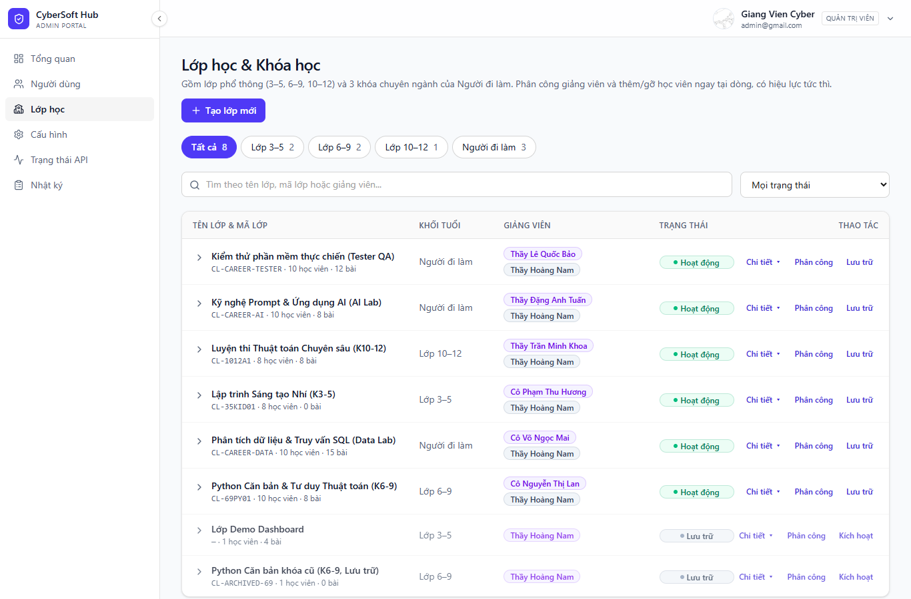
*Hình A.8 — Mỗi dòng gồm Tên lớp & Mã lớp (kèm số học viên, số bài), Khối tuổi, Giảng viên (nhãn tím = giảng viên chính), Trạng thái, Thao tác. Các tab ở trên kèm số lớp từng khối.*

| Tab | Ý nghĩa |
|---|---|
| **Tất cả** | Mọi lớp |
| **Lớp 3–5** | Lớp Kid Mode: học viên chơi game Blockly (Block Puzzle), không làm bài code/quiz |
| **Lớp 6–9** / **Lớp 10–12** | Lớp phổ thông: bài Code Python + Trắc nghiệm, giao theo Ngày, chấm máy |
| **Người đi làm** | 3 khóa chuyên ngành: Tester QA (`CL-CAREER-TESTER`), Data Lab (`CL-CAREER-DATA`), AI Lab (`CL-CAREER-AI`) |

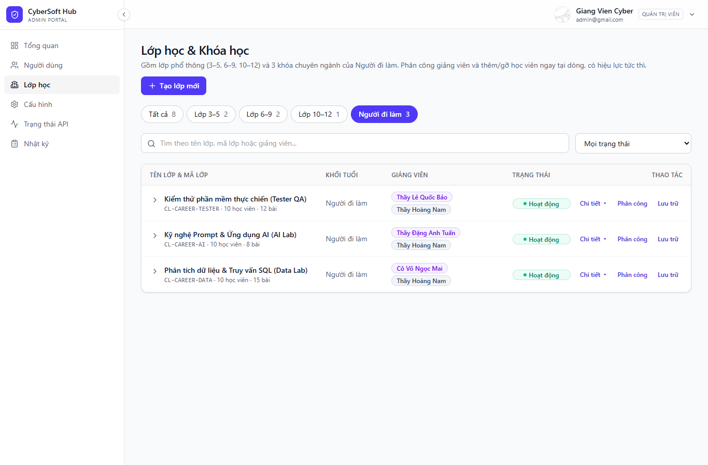
*Hình A.9 — 3 khóa Người đi làm.*

**Cơ chế đặc thù của 3 khóa Người đi làm:** mọi tài khoản khối *Người đi làm* đang hoạt động **tự động học đủ cả 3 khóa**, nên ở chi tiết lớp không có nút Thêm/Gỡ học viên (giao diện ghi: "Mọi tài khoản Người đi làm đang hoạt động đều học đủ 3 khóa, nên không thêm/gỡ thủ công."). Sĩ số được tính từ số tài khoản Người đi làm, không lưu danh sách riêng. Bài trong các khóa này là Lab cố định; Data Lab / AI Lab tự chấm trên sandbox, Tester QA do giảng viên chấm theo rubric (mục B6).

Thanh tìm kiếm tìm theo **tên lớp, mã lớp hoặc tên giảng viên**; bộ lọc trạng thái có *Đang hoạt động* và *Đã lưu trữ*.

### A2.2 Tạo lớp học mới

**Bước 1.** Bấm **+ Tạo lớp mới**.

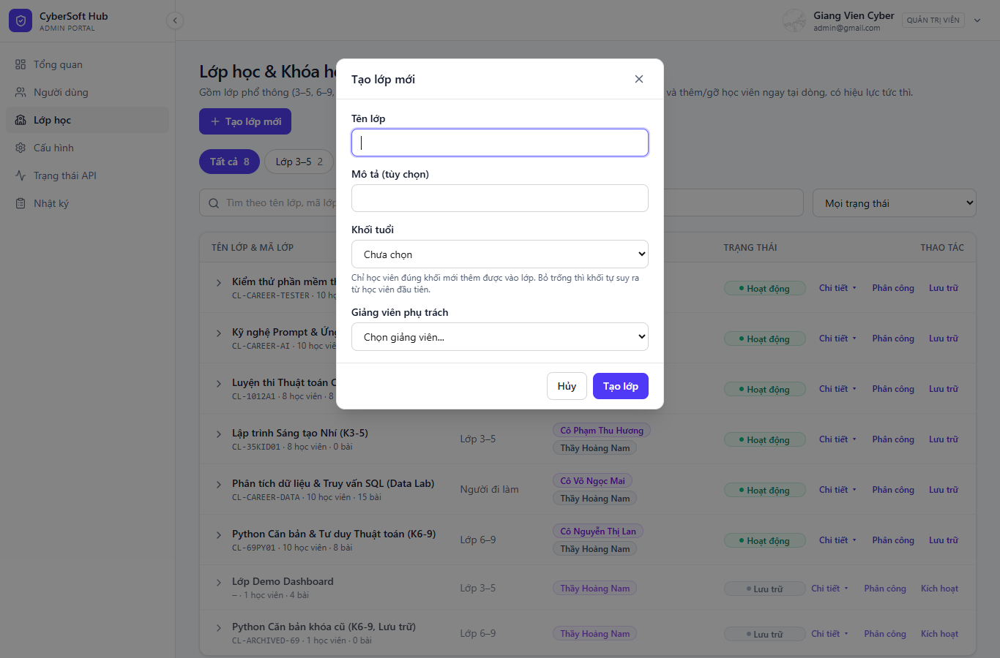
*Hình A.10 — Form Tạo lớp mới.*

**Bước 2.** Nhập **Tên lớp** (bắt buộc) và **Mô tả** (tùy chọn).

**Bước 3.** Chọn **Khối tuổi**. Chỉ học viên đúng khối mới thêm được vào lớp. Nếu bỏ trống, khối tự suy ra từ học viên đầu tiên.

**Bước 4.** Chọn **Giảng viên phụ trách** (bắt buộc; danh sách chỉ có giảng viên đang hoạt động).

**Bước 5.** Bấm **Tạo lớp**. **Mã lớp được sinh tự động** dạng `CL-` + 6 ký tự (bỏ các ký tự dễ nhầm như 0/O, 1/I), ví dụ `CL-7KQ2HN`; Admin không cần tự đặt mã.

### A2.3 Phân công giảng viên

**Bước 1.** Bấm **Phân công** ở cuối dòng lớp (hoặc bấm vào dòng để xổ chi tiết rồi bấm **Phân công GV**).

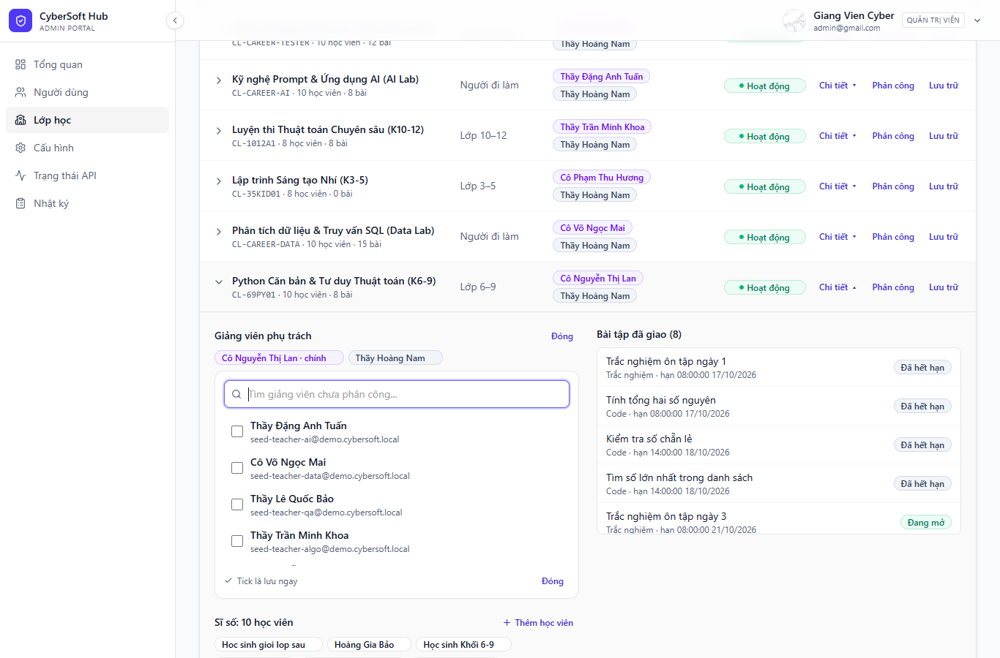
*Hình A.11 — Khung "Giảng viên phụ trách": nhãn đầu tiên có chữ **· chính**. Bên dưới là danh sách giảng viên chưa phân công kèm ô tìm. Dòng chú thích **"✓ Tick là lưu ngay"**. Bên phải là danh sách bài đã giao của lớp và cửa sổ hạn (Đã hết hạn / Đang mở).*

**Bước 2.** Tick ô trước tên giảng viên. **Không có nút Lưu**: mỗi lần tick là một lần lưu (giao diện hiện "Đang lưu..." rồi trở lại "Tick là lưu ngay"). Quyền mới có hiệu lực ngay ở request kế tiếp của giảng viên. Một lớp có tối đa 10 giảng viên; người đầu danh sách là giảng viên chính.

**Bước 3.** Gỡ giảng viên: bấm dấu **×** trên nhãn tên. Lớp phải còn ít nhất một giảng viên (nút gỡ bị mờ, gợi ý "Lớp cần ít nhất một giảng viên").

**Xử lý "ID ma" (giảng viên đã bị xóa / bị khóa / bị đổi vai trò):**

| Nhãn trên giao diện | Nghĩa | Cách xử lý |
|---|---|---|
| **Giảng viên không còn tồn tại** | ID trong lớp trỏ tới tài khoản đã bị xóa hoặc không còn là giảng viên | Bấm **×** để gỡ, **kể cả khi đó là nhãn duy nhất**; rồi tick giảng viên mới |
| Tên bị gạch ngang, nền xám, "· Đã khóa" | Giảng viên đang bị khóa | Vẫn được giữ trong lớp (lịch sử phân công). Gỡ và gán người khác nếu cần |
| **Chưa gán** (nhãn vàng) | Lớp không có giảng viên | Tick một giảng viên |

Backend tự dọn: khi Admin tick thêm người mới, các ID cũ không còn là giảng viên **được gỡ tự động** thay vì làm hỏng cả request (đây là bản vá lỗi C1 — trước đây một ID ma làm mọi lần phân công báo "Chỉ gán được tài khoản giảng viên đang hoạt động"). Người *mới* thêm vẫn phải là giảng viên đang hoạt động; nếu không, API trả `400 E400_INVALID_TEACHERS` kèm danh sách `invalidIds`.

### A2.4 Quản lý học viên trong lớp

**Bước 1.** Bấm vào dòng lớp để xổ chi tiết, nhìn mục **Sĩ số: N học viên**.

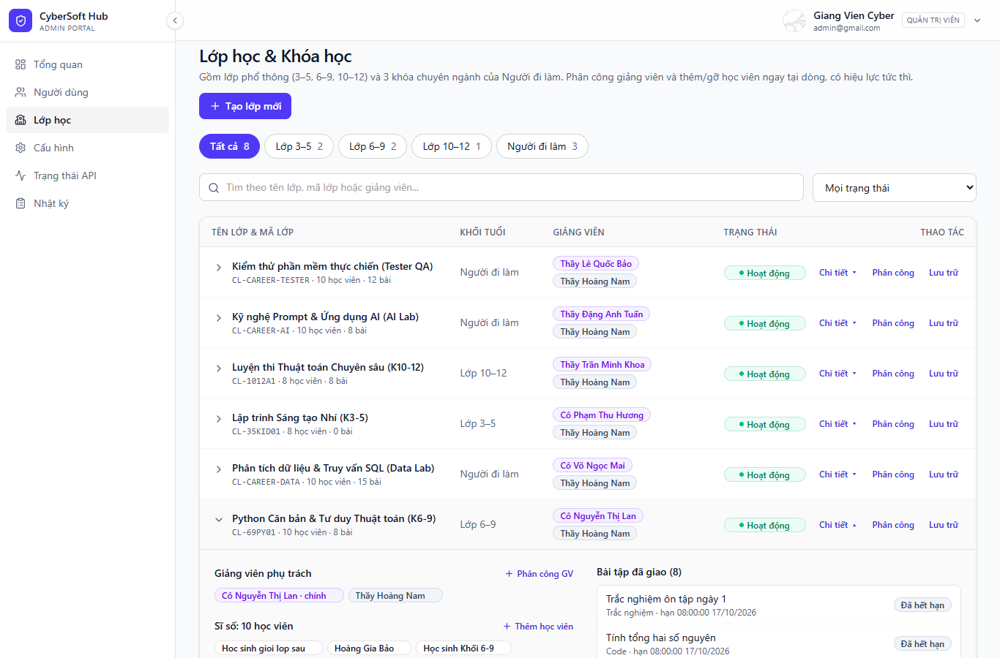
*Hình A.12 — Chi tiết lớp: giảng viên phụ trách, sĩ số (mỗi học viên một nhãn có nút ×), bài tập đã giao.*

**Bước 2.** Bấm **+ Thêm học viên**. Có hai cách:

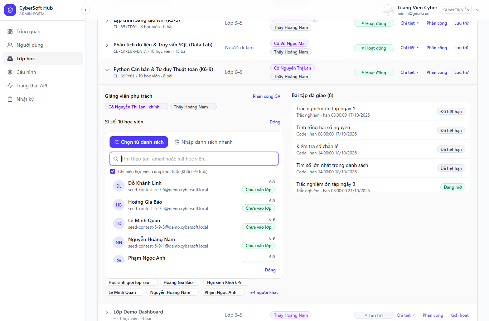
*Hình A.13 — Tab **Chọn từ danh sách**: tìm theo tên, email hoặc mã học viên; học viên chưa thuộc lớp nào có nhãn xanh "Chưa vào lớp".*

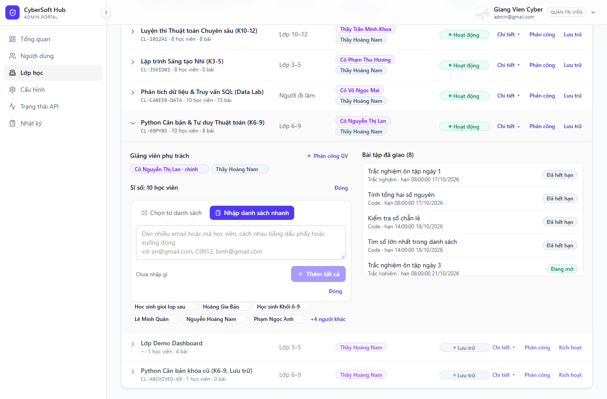
*Hình A.14 — Tab **Nhập danh sách nhanh**: dán nhiều email hoặc mã học viên (vd `an@gmail.com, C0012, binh@gmail.com`), cách nhau bằng dấu phẩy hoặc xuống dòng. Bộ đếm "N mục hợp lệ" hiện ngay khi dán.*

**Bước 3.** Bấm chọn (hoặc **Thêm**). Kết quả tách rõ: đã thêm, đã có trong lớp, không tìm thấy. Nếu có mục không hợp lệ thì **chưa thêm ai** (giao diện ghi "Chưa thêm ai.") để tránh thêm nửa chừng.

**Bước 4.** Gỡ học viên: bấm **×** trên nhãn tên → thông báo "Đã gỡ … khỏi lớp."

**Sĩ số thực** = số học viên đang có trong lớp, đếm lại mỗi lần tải; các thao tác thêm/gỡ cập nhật ngay trên màn hình (nếu máy chủ từ chối, giao diện tự hoàn tác).

### A2.5 Lưu trữ / Kích hoạt lại lớp

Bấm **Lưu trữ** ở cuối dòng → xác nhận. Lớp lưu trữ không còn nhận bài nộp, giảng viên chỉ xem lại lịch sử. Bấm **Kích hoạt** để mở lại bất cứ lúc nào.

## A3. Giám sát sức khỏe dữ liệu `/admin/health`

**Bước 1.** Bấm **Trạng thái API** ở thanh bên trái.

**Bước 2.** Bấm **Kiểm tra toàn bộ hệ thống ngay**. Hệ thống kiểm tra song song 5 cụm, mỗi cụm tối đa 2 giây.

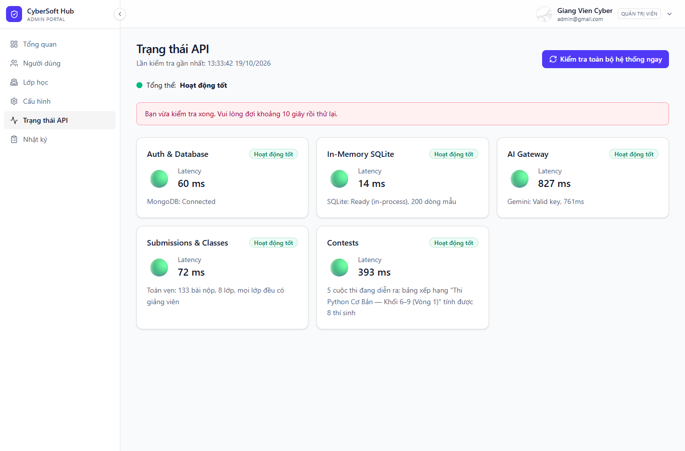
*Hình A.15 — 5 thẻ: Auth & Database, In-Memory SQLite, AI Gateway, Submissions & Classes, Contests. Mỗi thẻ có trạng thái, độ trễ (latency) và mô tả. Dải đỏ "Bạn vừa kiểm tra xong. Vui lòng đợi khoảng 10 giây" xuất hiện vì trang tự kiểm tra khi mở và giới hạn 1 lần / 10 giây.*

**Data Health Check nằm ở thẻ "Submissions & Classes":**

| Mô tả hiển thị | Trạng thái | Ý nghĩa và cách xử lý |
|---|---|---|
| `Toàn vẹn: N bài nộp, M lớp, mọi lớp đều có giảng viên` | Hoạt động tốt | Không cần làm gì |
| `K lớp chưa có giảng viên phụ trách` | Suy giảm (DEGRADED) | Vào Lớp học, tìm nhãn vàng **Chưa gán**, tick giảng viên |
| `K lớp có giảng viên không còn tồn tại hoặc đang bị khóa` | Suy giảm (DEGRADED) | Tìm nhãn "Giảng viên không còn tồn tại" hoặc tên gạch ngang, gỡ và gán người khác |

Cách phát hiện: máy chủ nối (`$lookup`) từng `teacherId`/`teacherIds` của lớp với bảng `users` và đếm lớp có giảng viên không tồn tại, không còn vai trò TEACHER, hoặc đang LOCKED. Thẻ **AI Gateway** báo *Suy giảm* khi chưa cấu hình Gemini API key (AI chạy chế độ dự phòng).

Kiểm tra tương tự từ dòng lệnh (không cần đăng nhập): `GET http://localhost:3000/api/health` (xem [Runbook](OPERATIONS_RUNBOOK.md)).

## A4. Tổng quan, Cấu hình và Nhật ký

- **Tổng quan** (`/admin/dashboard`): Tổng người dùng, Lớp học đang mở, Bài nộp hôm nay, Bài chờ chấm, Học viên theo khối, Bài nộp 7 ngày gần nhất.
- **Cấu hình** (`/admin/settings`): nhập **Gemini API Key** (mã hóa AES-256-GCM khi lưu, không bao giờ hiển thị lại dạng đầy đủ, có hiệu lực ngay không cần khởi động lại) và sửa **System prompt** của AI. Cần biến `CONFIG_ENCRYPTION_KEY` trong `BE/.env`.
- **Nhật ký** (`/admin/audit`): mọi thao tác quản trị (phân công, lưu trữ, khóa, đổi cấu hình) kèm giá trị *Trước đây* / *Hiện tại*; lọc theo hành động, tìm theo email admin.

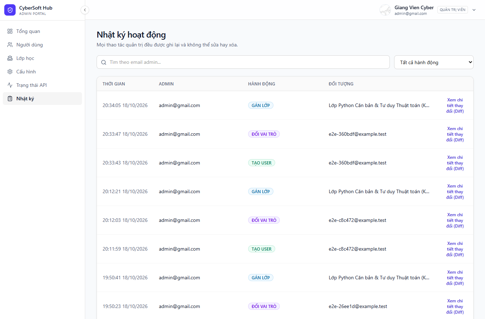
*Hình A.16 — Nhật ký hoạt động: không thể sửa hay xóa.*

---

# Phần B — Giảng viên (Teacher Studio V2)

Đăng nhập bằng tài khoản giảng viên (ví dụ `teacher6-9@gmail.com`). Thanh bên trái gồm: **Tổng quan · Lớp học của tôi · Chấm bài · Soạn đề · Cuộc thi**. Mục *Soạn đề → AI Tạo Đề / Ngân hàng đề* và *Cuộc thi* chỉ hiện với giảng viên đang phụ trách ít nhất một lớp **Khối 6–9 hoặc 10–12 còn hoạt động**; giảng viên chỉ dạy Khối 3–5 hoặc Người đi làm không thấy các mục này.

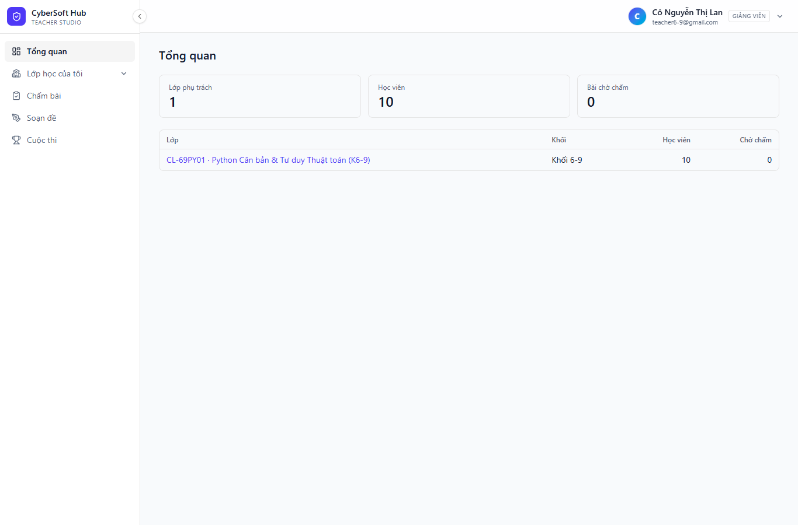
*Hình B.0 — Tổng quan: các thẻ số liệu (Lớp phụ trách, Học viên, Bài chờ chấm) và bảng lớp đang phụ trách kèm lối tắt.*

## B1. Lớp học của tôi `/teacher/classes`

### B1.1 Xem lớp, sĩ số và theo dõi học viên

**Bước 1.** Bấm **Lớp học của tôi**, chọn lớp trong danh sách con. Đường dẫn đổi thành `/teacher/classes?classId=...` nên F5 hay gửi link vẫn mở đúng lớp. Giảng viên **chỉ thấy lớp được Admin phân công**; mở lớp của người khác bằng ID trả 403.

**Bước 2.** Tab **Theo dõi học viên** liệt kê học viên, trạng thái nộp bài (Passed / Wrong Answer kèm điểm / Chưa nộp) và cảnh báo out-tab của **bài tập trong chính lớp đó** (cảnh báo của cuộc thi toàn trường không hiện ở đây).

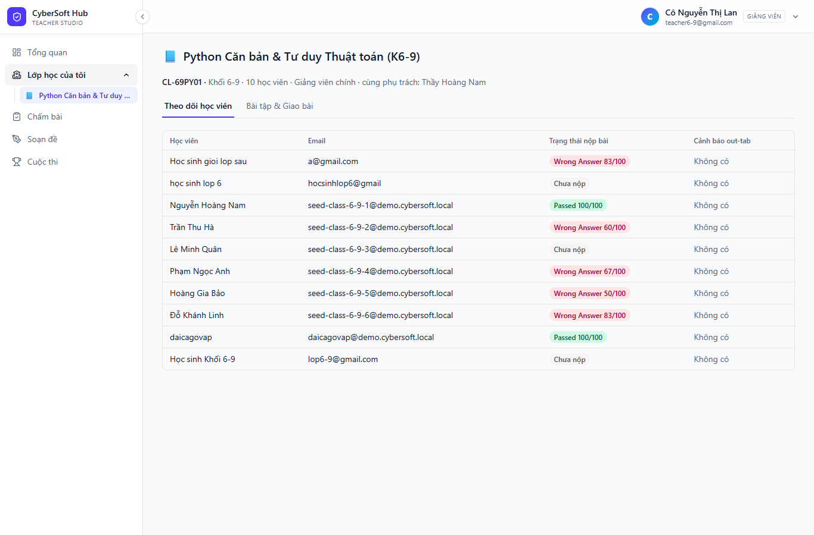
*Hình B.1 — Lớp `CL-69PY01`: dòng mô tả cho biết khối, sĩ số, giảng viên chính và người cùng phụ trách.*

### B1.2 Bảng điểm và vì sao Khối 6–9 / 10–12 có điểm Chính thức ngay

Khi lớp có bài đánh giá, bảng hiện thêm các cột điểm:

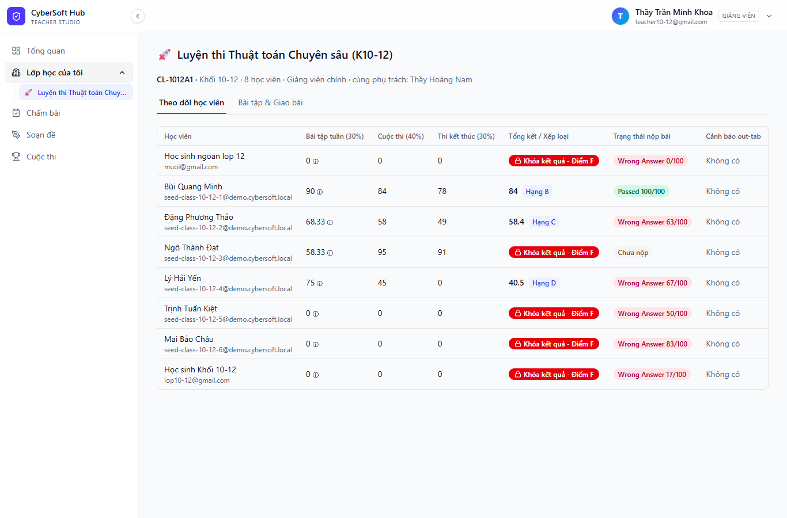
*Hình B.2 — Lớp `CL-1012A1`: Bài tập tuần (30%), Cuộc thi (40%), Thi kết thúc (30%), Tổng kết / Xếp loại. Quan sát: mọi dòng đều là **Hạng A–D** hoặc **Khóa kết quả - Điểm F**, không có dòng "Tạm thời (N bài chờ chấm)".*

| Quy tắc | Chi tiết |
|---|---|
| Công thức | Tổng kết = 0,3 × TB bài tập tuần + 0,4 × TB cuộc thi + 0,3 × điểm thi kết thúc |
| Bỏ bài thấp nhất | Bỏ 1 bài tập tuần điểm thấp nhất khi lớp có từ 2 bài (biểu tượng ⓘ "Đã loại bỏ 1 bài thấp nhất") |
| **Chuyên cần** | Bỏ nộp **> 30%** số bài tập tuần → **Khóa kết quả - Điểm F** |
| Chia lại trọng số | Lớp chưa tổ chức một loại đánh giá thì trọng số loại đó chia đều tỷ lệ cho các loại còn lại |
| Xếp loại | A ≥ 85 · B ≥ 70 · C ≥ 55 · D ≥ 40 · còn lại F |
| Bài code của lớp | Tổng điểm − 1 điểm cho mỗi lần Submit sai (WA/TLE/RE) trước lần AC đầu tiên, không dưới 0; lỗi cú pháp (CE) và bấm Run không bị trừ |

**Vì sao không bị treo "chờ chấm"?** Khối 6–9 và 10–12 chỉ có bài **Code** (máy chấm chạy test thật trên server) và **Trắc nghiệm** (chấm theo đáp án). Cả hai có điểm ngay khi nộp, vào thẳng trạng thái đã công bố (GRADED → PUBLISHED). Chỉ điểm đã công bố mới được tính, và với hai khối này không có bước giảng viên chấm tay, nên điểm luôn là **Chính thức**. Nhãn "Tạm thời (N bài chờ chấm)" chỉ còn ý nghĩa với bài cần chấm tay (Lab Tester QA của khóa Người đi làm).

### B1.3 Giao bài tập theo Ngày

**Bước 1.** Trong lớp Khối 6–9 hoặc 10–12, chọn tab **Bài tập & Giao bài**. Bài được tổ chức theo **Ngày 1, Ngày 2, ...** giống hệt màn hình học viên.

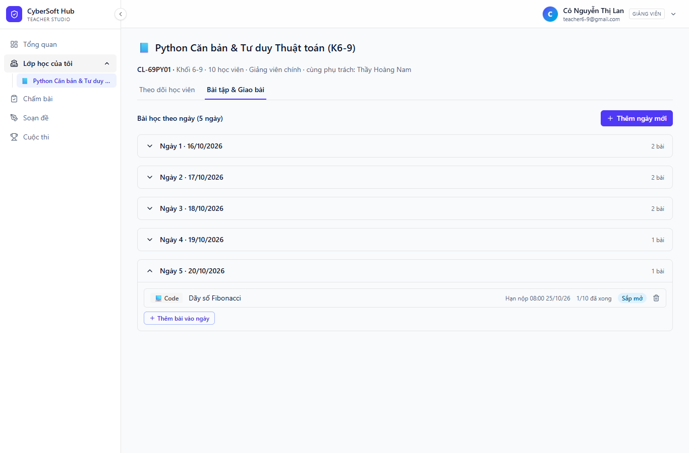
*Hình B.3 — Mỗi Ngày xổ ra danh sách bài: nhãn 💻 Code / 📝 Trắc nghiệm, **Hạn nộp**, số học viên đã xong (vd 1/10), cửa sổ thời gian (Sắp mở / Đang mở / Hết hạn) và nút thùng rác.*

**Bước 2.** Bấm **+ Thêm ngày mới** để tạo Ngày n+1 (ngày mới chỉ được lưu thật khi có bài đầu tiên).

**Bước 3.** Trong một Ngày, bấm **+ Thêm bài vào ngày**.

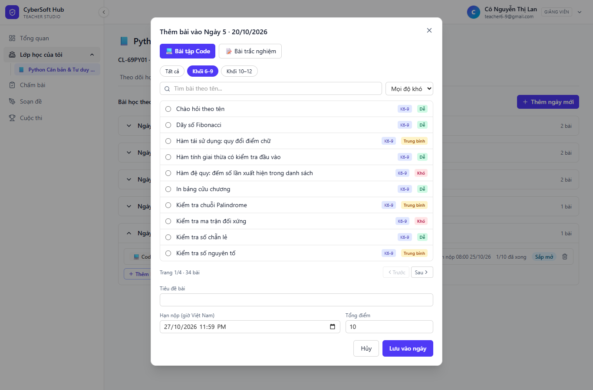
*Hình B.4 — Loại **Bài tập Code**: lọc khối (mặc định theo khối lớp), tìm theo tên, lọc độ khó, phân trang. Chọn **một** bài (nút tròn). Nhãn K6-9/K10-12 và Dễ/Trung bình/Khó hiện bên phải.*

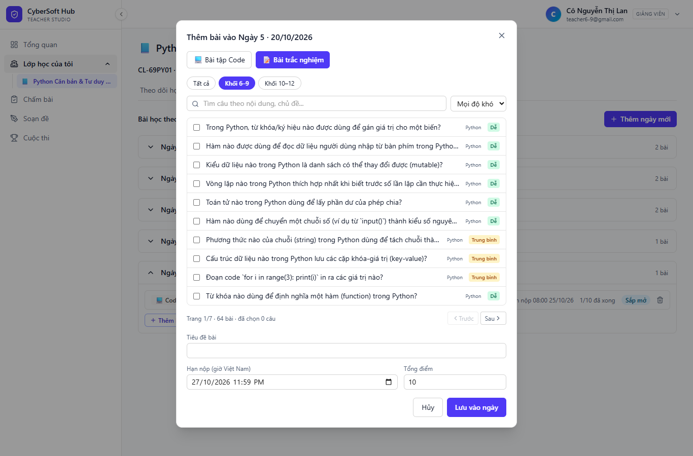
*Hình B.5 — Loại **Bài trắc nghiệm**: tick **nhiều** câu để ghép thành một bài; lựa chọn được giữ khi chuyển trang.*

**Bước 4.** Kiểm tra **Tiêu đề bài** (tự điền theo bài đã chọn, sửa được), đặt **Hạn nộp (giờ Việt Nam)** và **Tổng điểm**.

**Bước 5.** Bấm **Lưu vào ngày**. Học viên của lớp thấy bài ngay ở *Lớp học của tôi*. Bài giao trong lớp **không bị khóa tuần tự** như Code Playground: học viên làm được ngay dù bài đó nằm sau trong lộ trình.

**Lưu ý:**

- Hạn nộp do **máy chủ** kiểm tra: nộp sau hạn (mà chưa hoàn thành) hoặc trước giờ mở đều bị từ chối 403.
- Xóa bài khỏi lớp (thùng rác) sẽ khiến kết quả học viên đã làm cho bài đó **không còn được tính**; giao diện hỏi xác nhận trước.
- Lớp đã lưu trữ chỉ xem lại lịch sử, không thêm hay xóa bài.

## B2. Soạn bài thủ công `/teacher/authoring`

Trang **Soạn đề** có 3 tab con: **Soạn bài thủ công · AI Tạo Đề · Ngân hàng đề**. Teacher Studio chỉ soạn đề cho **Khối 6–9 và Khối 10–12**; Khối 3–5 (game kéo thả) và khóa Người đi làm (Lab cố định) không soạn tại đây.

### B2.1 Tạo Bài tập Code

**Bước 1.** Ở công tắc đầu trang, chọn **Bài tập Code**.

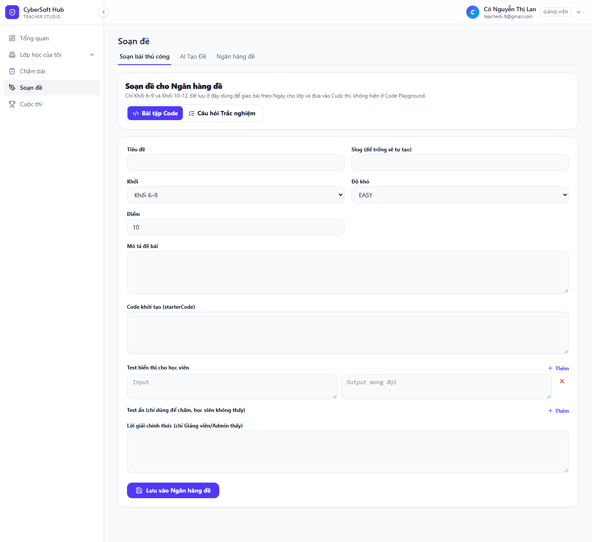
*Hình B.6 — Form Bài tập Code. Dòng mô tả ở đầu nhắc: "Đề lưu ở đây dùng để giao bài theo Ngày cho lớp và đưa vào Cuộc thi, không hiện ở Code Playground."*

**Bước 2.** Điền thông tin:

| Trường | Ghi chú |
|---|---|
| Tiêu đề | Bắt buộc |
| Slug | Để trống sẽ tự tạo |
| Khối | Khối 6–9 hoặc Khối 10–12 |
| Độ khó | EASY / MEDIUM / HARD |
| Điểm | Mặc định 10 |
| Mô tả đề bài | Bắt buộc |
| Giới hạn thời gian `timeLimitMs` / bộ nhớ `memoryLimitMb` | **Chỉ hiện khi chọn Khối 10–12** (mặc định 2000 ms / 128 MB); Khối 6–9 dùng giới hạn mặc định của máy chấm |
| Code khởi tạo (`starterCode`) | Code mẫu học viên thấy khi mở bài |
| **Test hiển thị cho học viên** | Bắt buộc ít nhất 1 test. Mỗi dòng: Input + Output mong đợi |
| **Test ẩn** | Chỉ dùng để chấm, học viên không bao giờ thấy |
| Lời giải chính thức | Chỉ Giảng viên/Admin thấy |

**Bước 3.** Bấm **+ Thêm** để thêm dòng test, **×** để xóa dòng. Dòng để trống cả Input lẫn Output tự bị bỏ khi lưu (giữ lại sẽ làm mọi lời giải đúng bị lỗi EOFError).

**Bước 4.** Bấm **Lưu vào Ngân hàng đề** → thông báo "Đã lưu vào Ngân hàng đề (Khối …). Bài dùng để giao cho lớp và đưa vào cuộc thi."

### B2.2 Tạo Câu hỏi Trắc nghiệm

**Bước 1.** Chọn **Câu hỏi Trắc nghiệm** ở công tắc đầu trang.

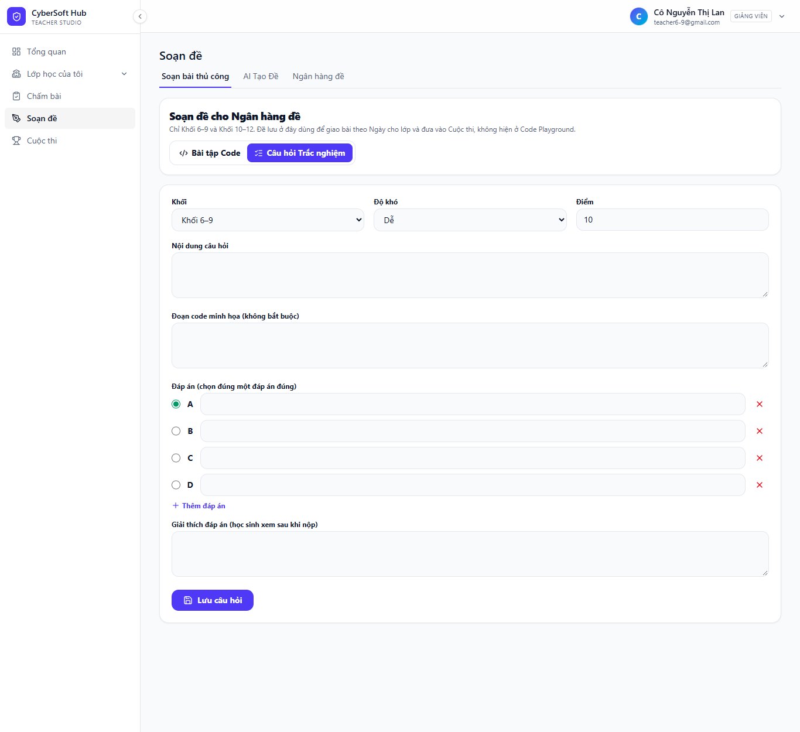
*Hình B.7 — Form câu trắc nghiệm.*

**Bước 2.** Chọn **Khối**, **Độ khó**, **Điểm**.

**Bước 3.** Nhập **Nội dung câu hỏi** và (không bắt buộc) **Đoạn code minh họa**.

**Bước 4.** Nhập **2 đến 6 đáp án**. Bấm **+ Thêm đáp án** (mờ đi khi đã đủ 6), **×** để xóa (mờ đi khi chỉ còn 2). Chọn **đúng một** đáp án đúng bằng nút tròn bên trái. Nhãn A, B, C... được đánh theo vị trí hiển thị.

**Bước 5.** Viết **Giải thích đáp án** (học sinh xem sau khi nộp).

**Bước 6.** Bấm **Lưu câu hỏi**.

### B2.3 Cơ chế `bankOnly: true` — vì sao bài của giảng viên không vào Code Playground

Mọi bài/câu do Giảng viên hoặc Admin tạo (thủ công, bằng AI, hay sửa lại) **luôn được lưu với `bankOnly: true`**, kèm nhãn khối `bankBand`. Hệ quả:

- Bài **chỉ dùng** để (a) giao theo Ngày cho lớp và (b) đưa vào đề Cuộc thi.
- Bài **không bao giờ** xuất hiện ở `/playground` (lộ trình cố định 20 bài Khối 6–9, 15 bài Khối 10–12, mở khóa tuần tự) và câu trắc nghiệm không lọt vào 3 bộ đề công khai ở `/quiz` (Python / HTML5 / CSS3, mỗi bộ 20 câu).
- Vì thế mẫu số tiến độ "X/20 bài" của học viên không bị thay đổi khi giảng viên thêm bài.

Lớp bảo vệ: (1) service luôn ghi `bankOnly: true`; (2) truy vấn Playground và quiz công khai loại `bankOnly`; (3) schema có chốt chặn; (4) audit `audit-day31.js` và E2E kiểm tra lại.

## B3. AI Tạo Đề `/teacher/authoring/ai`

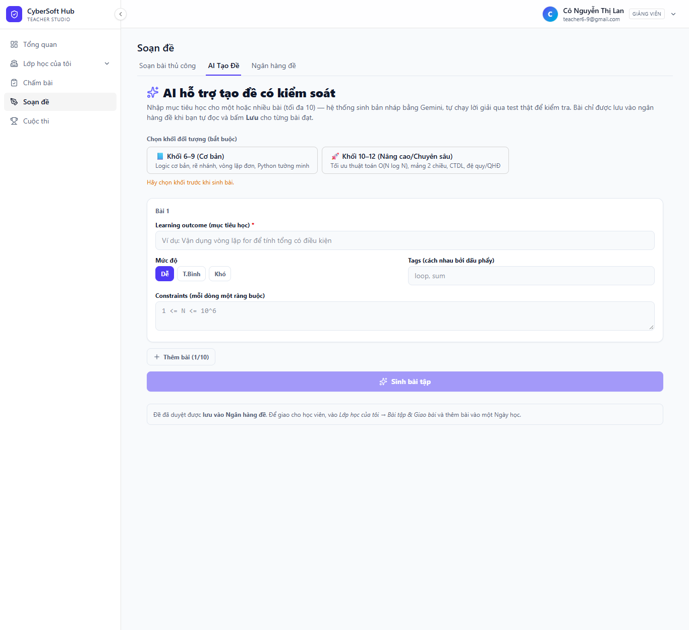
*Hình B.8 — "AI hỗ trợ tạo đề có kiểm soát". Nút **Sinh bài tập** bị mờ cho tới khi chọn khối.*

**Bước 1.** **Chọn khối đối tượng (bắt buộc)**: *Khối 6–9 (Cơ bản)* — logic cơ bản, rẽ nhánh, vòng lặp đơn; hoặc *Khối 10–12 (Nâng cao/Chuyên sâu)* — tối ưu O(N log N), mảng 2 chiều, CTDL, đệ quy/QHĐ.

**Bước 2.** Với mỗi bài, nhập **Learning outcome (mục tiêu học)** (bắt buộc), chọn **Mức độ** (Dễ / T.Bình / Khó), **Tags** (cách nhau dấu phẩy) và **Constraints** (mỗi dòng một ràng buộc, vd `1 <= N <= 10^6`).

**Bước 3.** Bấm **+ Thêm bài** để sinh nhiều bài một lượt (tối đa 10), rồi bấm **Sinh bài tập**. AI (Gemini) trả về đề bài, test case và lời giải mẫu (*Reference solution*).

**Bước 4 — Cơ chế kiểm định an toàn (tự động):**

1. **Chống ảo giác đáp án:** Output mong đợi của mọi test **không lấy từ con số AI tự nhẩm**, mà là stdout thật khi máy chủ chạy lời giải mẫu trong **Local Python Sandbox** (Python 3.10+, giới hạn thời gian/bộ nhớ, chặn module nguy hiểm).
2. **Bắt buộc pass 100% test:** nút **Lưu vào ngân hàng đề** chỉ bật khi lời giải mẫu chạy qua *mọi* test (gợi ý: "Chỉ lưu được khi reference solution pass mọi test").
3. **Kiểm tra trùng lặp:** *Nghi vấn trùng lặp* (cảnh báo mềm) → bạn tự đối chiếu, tick xác nhận bỏ qua và có thể ghi lý do; hệ thống ghi lại người duyệt, thời điểm và lý do vào bài. *Trùng gần như tuyệt đối* (cùng slug/tiêu đề hoặc nội dung giống hệt) → **không thể lưu kể cả khi xác nhận**.
4. **Máy chủ không tin trình duyệt:** khi bấm Lưu, máy chủ chạy lại toàn bộ kiểm tra trên; sửa phản hồi trên trình duyệt không vượt qua được.

**Bước 5.** Nếu sửa tay đề/test/lời giải, bấm **Chạy lại test** (không gọi lại Gemini, không tốn quota). Khi đạt, bấm **Lưu vào ngân hàng đề**. Bài lưu với `bankOnly: true`. Để giao cho học viên: *Lớp học của tôi → Bài tập & Giao bài → Thêm bài vào ngày*.

> Chưa cấu hình `GEMINI_API_KEY` thì AI dùng chế độ dự phòng; Admin nhập key ở *Cấu hình*.

## B4. Ngân hàng đề `/teacher/authoring/bank`

### B4.1 Hai tab, bộ lọc và tìm kiếm

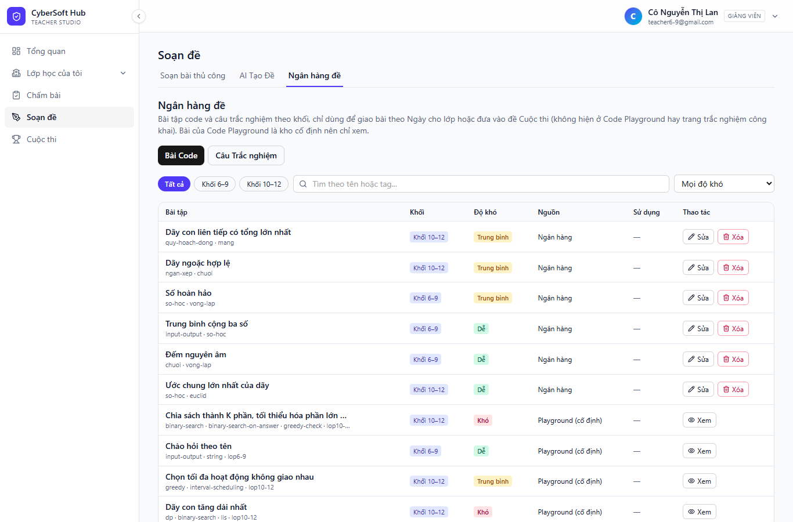
*Hình B.9 — Tab **Bài Code**: 10 bài/trang. Cột **Nguồn**: *Ngân hàng* (bài giảng viên/AI tạo, sửa/xóa được) hoặc *Playground (cố định)* (chỉ có nút **Xem**). Cột **Sử dụng** cho biết bài đang được gán ở lớp/cuộc thi.*

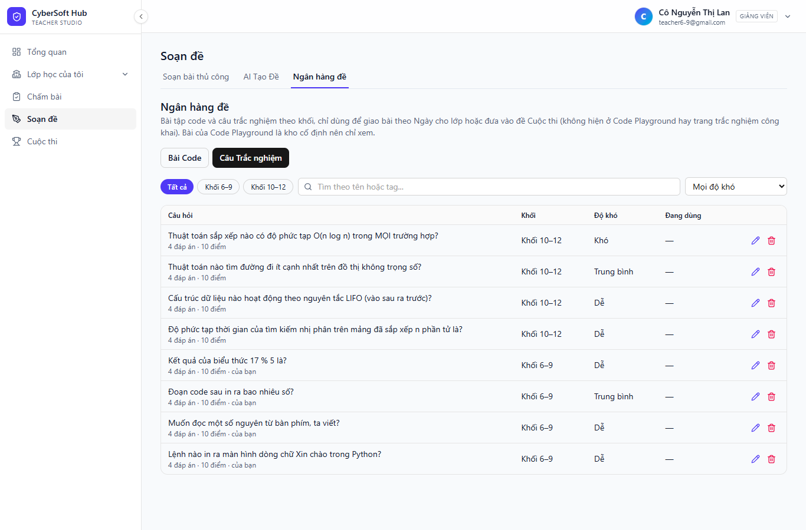
*Hình B.10 — Tab **Câu Trắc nghiệm**. Câu đang được dùng có nhãn "Đang dùng".*

Bộ lọc: **Tất cả / Khối 6–9 / Khối 10–12**, ô **Tìm theo tên hoặc tag...**, danh sách **Mọi độ khó / EASY / MEDIUM / HARD**.

### B4.2 Sửa bài

**Bước 1.** Bấm **Sửa** ở dòng bài.

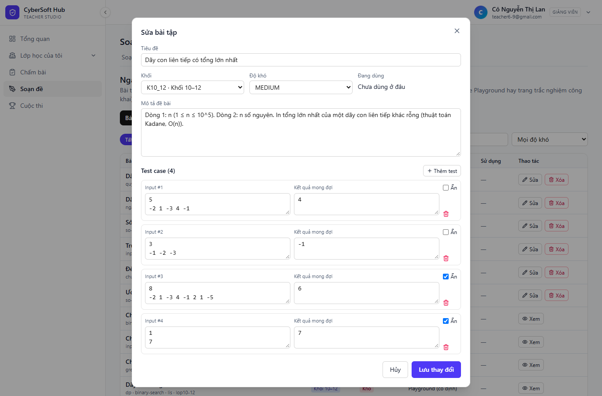
*Hình B.11 — Form sửa: tiêu đề, mô tả, khối, độ khó, test case.*

**Bước 2.** Sửa và bấm **Lưu thay đổi** → "Đã lưu bài tập." Slug và liên kết dữ liệu (lớp đã giao, cuộc thi) **giữ nguyên**, nên học viên đang làm vẫn thấy đúng bài. Bài đang được dùng **vẫn sửa được nội dung nhưng không đổi được khối** (409 `E409_BANK_EXERCISE_IN_USE`).

Bài *Playground (cố định)* chỉ xem: mọi thao tác sửa/xóa qua API trả `403 E403_PLAYGROUND_FIXED`.

### B4.3 Xóa bài và ràng buộc toàn vẹn dữ liệu

**Bước 1.** Bấm **Xóa** ở dòng bài.

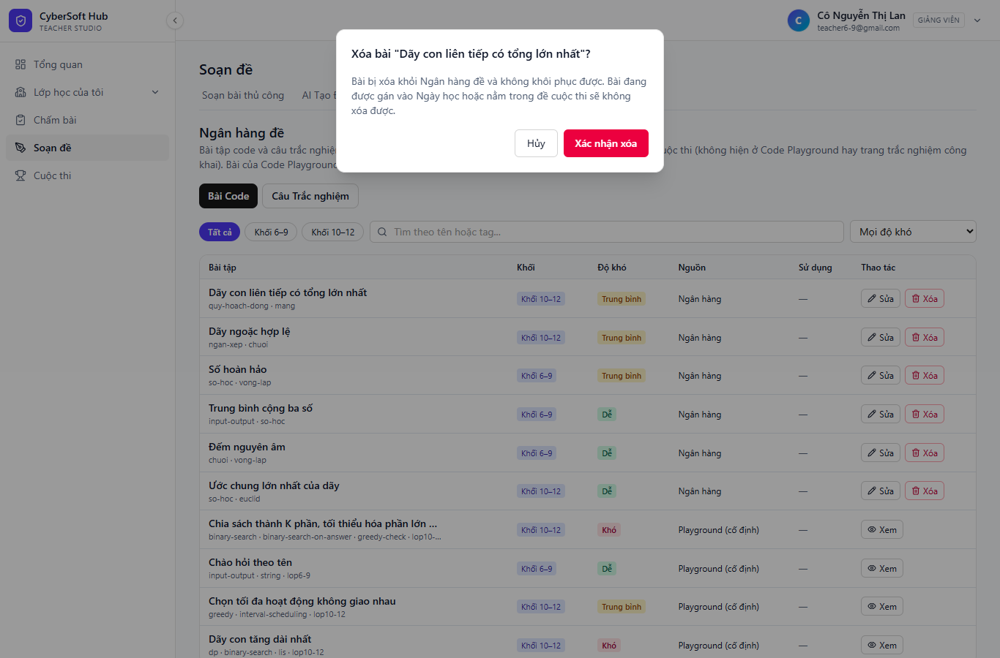
*Hình B.12 — Hộp xác nhận: "Bài bị xóa khỏi Ngân hàng đề và không khôi phục được. Bài đang được gán vào Ngày học hoặc nằm trong đề cuộc thi sẽ không xóa được."*

**Bước 2.** Bấm **Xác nhận xóa**.

- Bài chưa dùng ở đâu → bị xóa.
- Bài đang được gán trong **Lớp học** (bài giao theo Ngày) hoặc **Cuộc thi** → máy chủ chặn **409 `E409_BANK_EXERCISE_IN_USE`**, giao diện báo "Không thể xóa bài tập đang được sử dụng trong Lớp học hoặc Cuộc thi". Muốn xóa: gỡ bài khỏi Ngày học / đề cuộc thi trước.

Quyền: giảng viên chỉ sửa/xóa được bài do chính mình tạo hoặc bài Ngân hàng chung không có tác giả (bài của người khác trả `403 E403_NOT_OWNER`); Admin sửa được mọi bài Ngân hàng.

## B5. Tổ chức Cuộc thi `/teacher/contests`

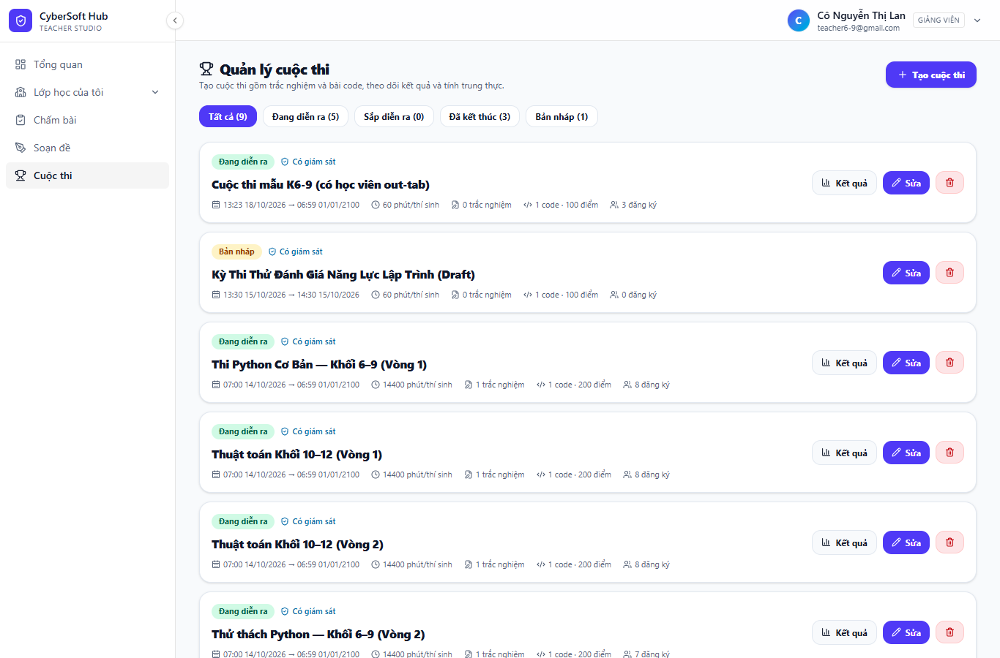
*Hình B.13 — Các bộ lọc trạng thái (Đang diễn ra / Sắp diễn ra / Đã kết thúc / Bản nháp), mỗi cuộc thi có nhãn "Có giám sát" nếu bật liêm chính và các nút **Kết quả**, **Sửa**, **Xóa**.*

### B5.1 Tạo cuộc thi mới (3 bước)

**Bước 1.** Bấm **+ Tạo cuộc thi**. Trình tạo có 3 bước: **Thông tin → Đề thi → Giám sát & xuất bản**.

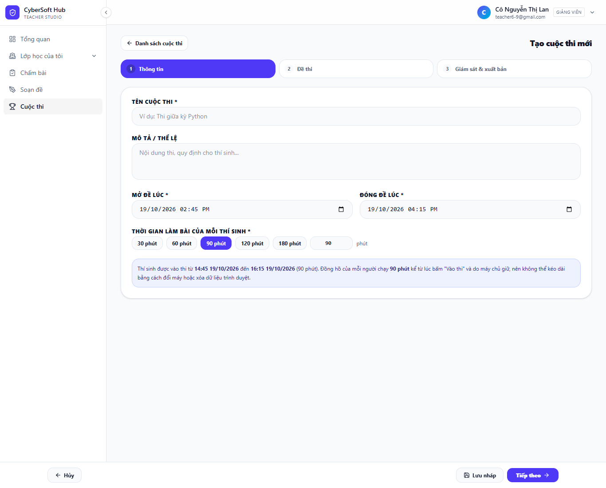
*Hình B.14 — Bước Thông tin.*

**Bước 2 — Thông tin.** Nhập **Tên cuộc thi \***, **Mô tả / thể lệ**, giờ **bắt đầu** và **kết thúc** (thí sinh được vào thi trong khoảng này), **Thời gian làm bài của mỗi thí sinh \*** (phút) và **Khối được dự thi** (*Mở cho mọi khối* / *Chỉ Khối 6–9* / *Chỉ Khối 10–12*). Mọi học sinh đều thấy cuộc thi, nhưng chỉ học sinh đúng khối vào được phòng thi (khác khối nhận 403).

**Bước 3 — Đề thi.** Chọn **Nguồn đề**: *Ngân hàng bài code* (bài Python có sẵn test case, gồm bài AI tạo), *Bài tự soạn*, hoặc ghép một *phần thi trắc nghiệm* từ câu hỏi trong ngân hàng (đặt tên phần thi). Sắp xếp thứ tự bằng nút Chuyển lên/xuống. Bài chưa có test case/câu hỏi không chọn được vì không chấm được. Chưa có đề thì chỉ **lưu nháp** được.

**Bước 4 — Giám sát & xuất bản.** Bật **Bật tín hiệu liêm chính (khuyến nghị)**, xem lại tóm tắt, rồi **Lưu nháp** hoặc **Xuất bản**.

### B5.2 Giám sát chống gian lận (Anti-cheat & Proctoring)

Khi bật giám sát, trình duyệt của thí sinh báo về máy chủ mỗi lần **rời màn hình thi** (chuyển tab, thu nhỏ cửa sổ, mất focus — sự kiện `visibilitychange`/`blur`). Một lần rời chỉ được tính khi vắng mặt **kéo dài từ 5 giây**, để tránh bắt nhầm thao tác lỡ tay. Kèm theo đó là nhịp heartbeat 5 giây/lần giúp máy chủ phân biệt mất mạng với gián đoạn đáng ngờ. Bộ đếm chính thức và ngưỡng xử lý nằm **ở máy chủ** (`proctor-rules.ts`):

| Số lần rời màn hình | Cuộc thi | Bài tập lớp |
|---|---|---|
| Lần 1–2 | Báo ngay cho giảng viên (mức Cảnh báo) | Chỉ ghi nhận |
| **Lần 3** | **Khóa phòng thi và tự động nộp bài**, đánh dấu `OUT_TAB_FORCE_SUBMIT`, báo giảng viên (mức Khóa) | Báo giảng viên "đã rời màn hình làm bài > 2 lần" |

Hệ thống **không tự trừ điểm, không tự hủy bài và không tự kết luận gian lận**: quyết định cuối cùng thuộc về giảng viên.

**Xem xét vi phạm:** bấm **Kết quả** ở cuộc thi → bảng thí sinh có cột Out-tab, Tương đồng mã, Trung thực; mục **Ưu tiên cần xem xét** lên đầu. Với thí sinh vi phạm:

- **Không công nhận kết quả**: nhập **Lý do không công nhận** (tối thiểu 10 ký tự) → thí sinh chuyển trạng thái DISQUALIFIED, có ghi Nhật ký;
- **Khôi phục**: hoàn tác quyết định nếu xem xét lại thấy hợp lệ.

## B6. Chấm bài & Phản hồi `/teacher/grading`

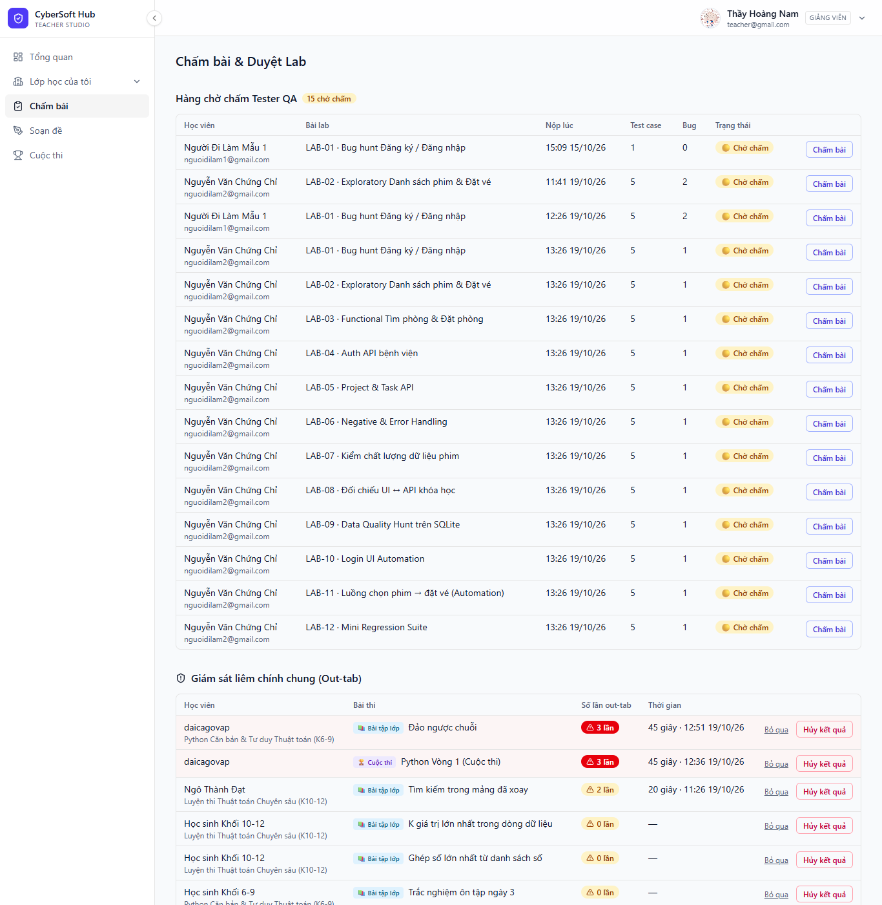
*Hình B.15 — Trang của `teacher@gmail.com`: khu 1 "Hàng chờ chấm Tester QA" (nhãn 🟡 Chờ chấm, nút **Chấm bài**), khu 2 "Giám sát liêm chính chung (Out-tab)" với nhãn nguồn *Bài tập lớp* / *Cuộc thi*, số lần out-tab và các nút **Bỏ qua** / **Hủy kết quả**.*

### B6.1 Chấm bài Lab cần chấm tay

Bài code và trắc nghiệm của Khối 6–9 / 10–12 được máy chấm tự động nên **không vào hàng chờ này**. Hàng chờ chỉ chứa bài Lab của lớp **Tester QA** (bug report, test case) — loại bài cần người đánh giá.

**Bước 1.** Bấm **Chấm bài** ở dòng bài nộp. Bảng hiện *Kết quả mong đợi* và bài làm của học viên.

**Bước 2.** Nhập điểm từng tiêu chí rubric (tổng hiển thị "Điểm theo rubric · tổng X/Y").

**Bước 3.** Viết **Nhận xét gửi học viên** (bắt buộc, tối thiểu 20 ký tự).

**Bước 4.** Bấm **Hoàn tất chấm điểm** (nút chỉ bật khi đã đủ điểm mọi tiêu chí và nhận xét đủ dài). Bài chuyển sang đã chấm và học viên thấy điểm cùng nhận xét.

### B6.2 Xử lý cảnh báo liêm chính

Lọc theo nguồn qua nhãn *Bài tập lớp* (kèm tên lớp) hoặc *Cuộc thi*. Với mỗi cảnh báo:

- **Bỏ qua**: cảnh báo không có căn cứ → "Đã bỏ qua cảnh báo.";
- **Hủy kết quả**: nhập *Lý do hủy kết quả* (bắt buộc, tối thiểu 10 ký tự) → bài nộp chuyển INVALIDATED (điểm về 0), ghi Nhật ký.

---

## Phụ lục — Bảng mã lỗi thường gặp

| Mã / thông báo | Xảy ra khi | Cách xử lý |
|---|---|---|
| `409` "Giảng viên đang phụ trách N lớp…" | Khóa / thu hồi quyền giảng viên còn đứng lớp | Chuyển giao lớp trước (A1.4) |
| `409` "Email đã được sử dụng." | Tạo người dùng trùng email | Dùng email khác |
| `409` "Đây là Admin hoạt động cuối cùng…" | Khóa Admin cuối cùng | Không được phép |
| `400 E400_INVALID_TEACHERS` | Phân công tài khoản không phải giảng viên đang hoạt động | Chọn giảng viên khác (A2.3) |
| `409 E409_BANK_EXERCISE_IN_USE` | Xóa/đổi khối bài đang dùng ở lớp hoặc cuộc thi | Gỡ bài khỏi Ngày học / cuộc thi trước (B4.3) |
| `403 E403_PLAYGROUND_FIXED` | Sửa/xóa bài Playground cố định | Chỉ xem được |
| `403 E403_QUESTION_BANK_NOT_ELIGIBLE` | Giảng viên không phụ trách lớp 6–9/10–12 vào Ngân hàng đề | Nhờ Admin phân công lớp phù hợp |
| `403` "đã hết hạn - đã khóa" | Học viên nộp bài lớp sau hạn | Giảng viên giao lại bài với hạn mới |
| `429` "Vui lòng đợi vài giây giữa hai lần kiểm tra" | Bấm kiểm tra sức khỏe hệ thống quá nhanh | Đợi 10 giây |

Sự cố kỹ thuật (máy chủ không phản hồi, thiếu Python, lỗi Cookie/CORS...) xem [OPERATIONS_RUNBOOK.md](OPERATIONS_RUNBOOK.md).
